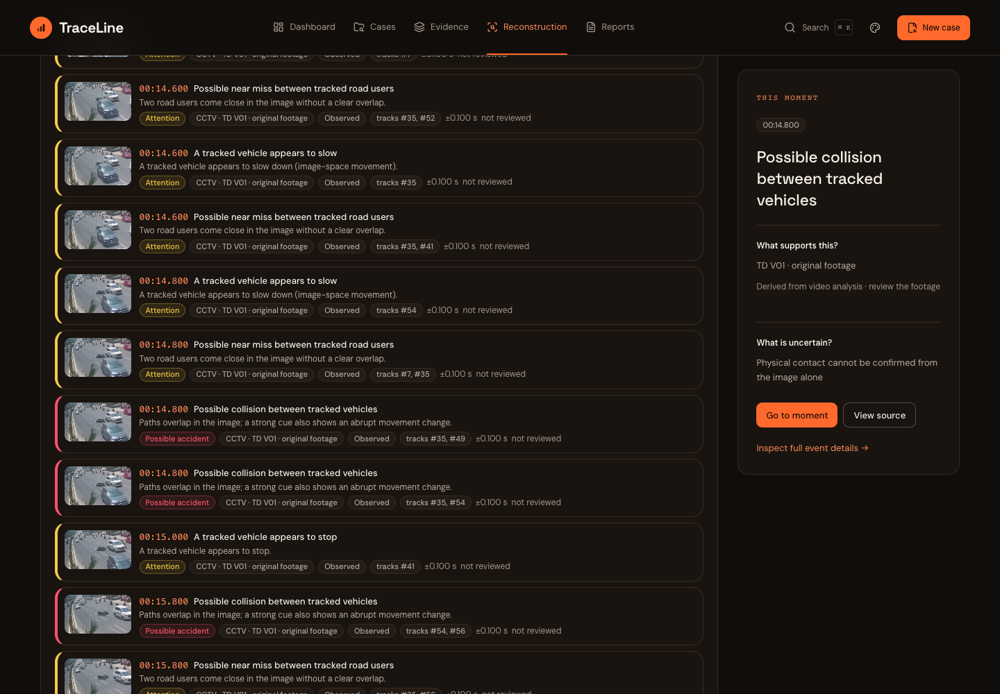
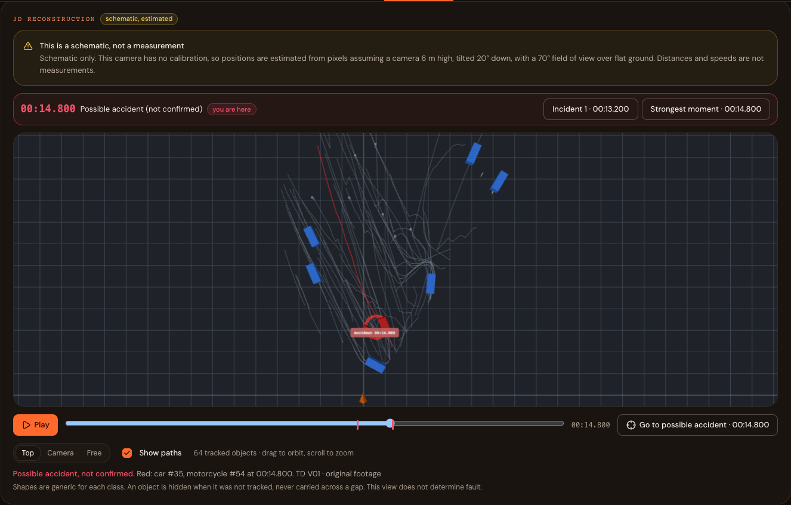
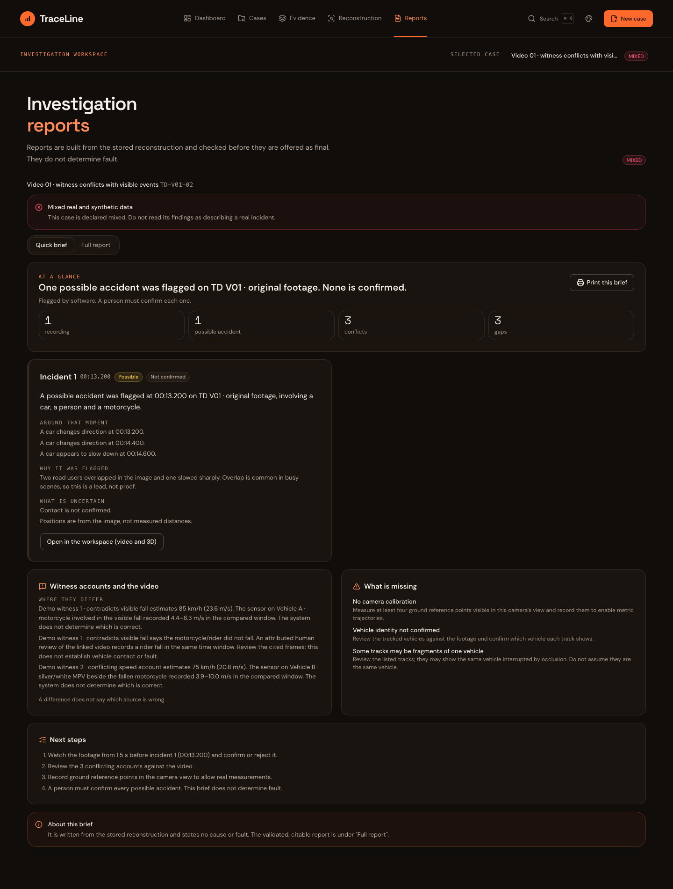
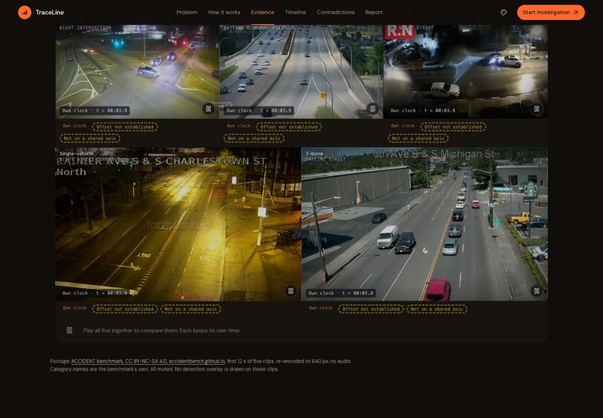
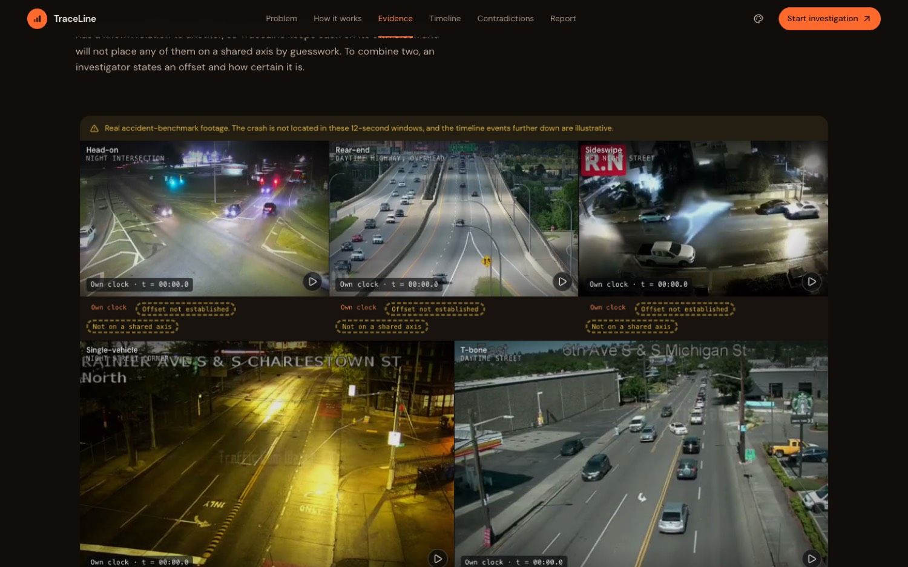

# 🚀 CBIT Hacktoberfest '26 — Project Starter Repository

> **Official Public Starter Repository for CBIT Hacktoberfest '26**  
> *Chaitanya Bharathi Institute of Technology (CBIT), Hyderabad*

---

## 📋 Team Information

| Attribute | Details |
| :--- | :--- |
| **Team Name** | **4Guys1Project** |
| **Team Number** | `TEAM-3` (`HFT26-TEAM-3`) |
| **Registration ID** | `HFEST26-2G4VXYA4` |
| **Problem Track** | **Track Selection in Progress** |
| **Domain** | `General Track` |
| **Team Leader** | J.Sanjeeth Manivandan (manwhaeditzz@gmail.com) |
| **Institution** | GRIET Hyderabad |

### 👥 Team Members

| # | Name | Email | Institution |
| :--- | :--- | :--- | :--- |
| 1 | Srihith Mucharla | srihithmucharla@gmail.com | GRIET Hyderabad |
| 2 | Meganath Baboori | meganathbaboori@gmail.com | GRIET Hyderabad |
| 3 | Rithvik Kesarla | rithvikkesarla@gmail.com | GRIET Hyderabad |

---

---

# TraceLine — AI-assisted reconstruction of road-accident evidence

> **It supports an investigation. It never assigns fault.** Observations, reports and inferences are kept apart, uncertainty stays visible, and nothing is shown that was not found in the evidence.

**Live demo (frontend):** https://traceline-cbit.vercel.app — the API behind it currently runs on a team laptop, so the demo is available only while that laptop is online. The jury cases below are preloaded there.

## 🎯 Problem Statement
*Domain:* **General Track** — AI-Powered Timeline Reconstruction for Road Accident Forensics. Track selection in progress.

## 📌 Solution Overview
Accident evidence is scattered across dashcams, CCTV, witness statements and vehicle sensor logs, each on its own clock. TraceLine lines these sources up on one timeline, detects and tracks road users in the video, flags **possible** accident moments, shows where sources agree or conflict, lists what evidence is missing, and produces a validated report.

**Special features of this version**
- **Detailed incident timeline:** event cards with thumbnails and Possible accident / Attention / Everything filters, plus a lane timeline, all following one playback clock.
- **Automatic pause** at a possible accident, with the keyframe, the reason and the uncertainty, and an investigator decision that is kept separate from the machine's output.
- **3D schematic incident view** (three.js): the stored tracks replayed in 3D with accident timestamps, a marker on the replay slider and in the scene. Positions are calibrated ground-plane metres when a camera is calibrated, otherwise an estimate with the assumptions stated on screen. It is a visual aid, not a measurement.
- **Quick-brief report:** an at-a-glance summary and one block per incident (what is around that moment, why it was flagged, what is uncertain), then witness accounts versus the video, what is missing and next steps. The validated full report stays one click away.
- **Automatic AI analysis (Featherless, opt-in):** when a case allows it, a grounded video narrative, a clearly-labelled *simulated* OBD series and witness-versus-video findings are produced in the background and validated against the stored tracks and frame times before they are shown.
- **Redesigned landing page** with five different real recordings, each on its own clock, and a synchronised multi-camera example with measured offsets.

## 🏗️ Architecture & Tech Stack
| Layer | Technology |
| :--- | :--- |
| Frontend | React 18, Vite, Tailwind CSS, Framer Motion, Zustand, three.js (lazy-loaded) |
| Backend | FastAPI, SQLAlchemy, Alembic, PostgreSQL (integrity triggers keep originals and the audit log immutable) |
| Vision | YOLO26 detection, ByteTrack/BoT-SORT tracking, rule-based events, optional accident-cue model |
| AI | Featherless (Qwen) for narrative and comparison, bound to the stored evidence and gated per case |
| Hosting | Vercel (frontend) and Supabase (PostgreSQL); backend on a team machine behind a tunnel |

See `docs/` for the architecture, data flow and evidence-integrity notes.

## 🚀 Local Setup & Installation
### Fresh clone: Windows, macOS or Linux

Requirements: **Python 3.11+**, **Node.js/npm**, and **PostgreSQL 16+**. FFmpeg/ffprobe and detection models are needed for video processing, but **not for creating a case**.

Run all setup commands from the **repository root**, the folder containing this README. The backend reads `.env` from that root, even when started from `backend/`.

1. Copy `.env.example` to `.env`:

   ```sh
   cp .env.example .env
   ```

   In Windows PowerShell use `Copy-Item .env.example .env`.

2. Set `DATABASE_URL` in `.env` to your running PostgreSQL database. This project requires PostgreSQL; SQLite is not supported. A local database can optionally be started using Docker:

   - Set `POSTGRES_PASSWORD` and the password in `DATABASE_URL` to the **same value**. URL-encode special characters in the URL password.
   - The template uses user/database `traceline` and port `5432`.
   - Run `docker compose up -d --wait db`.
   - If you change `POSTGRES_PORT`, also change the port in `DATABASE_URL`.
   - If you already have PostgreSQL, create an empty database and use that database's credentials instead.

3. Install dependencies and apply **all database migrations**:

   ```sh
   python setup-local.py
   ```

   Use `python3` instead of `python` if that is your Python 3 command. Windows can use `py -3.11 setup-local.py`. Setup creates `backend/.venv`, installs backend/frontend dependencies and upgrades the schema. It preserves existing cases. To apply migrations without reinstalling dependencies: `python setup-local.py --skip-install`.

4. Run both servers:

   ```sh
   python run-local.py
   ```

   Open **http://127.0.0.1:5176/**. API documentation is at **http://127.0.0.1:8010/docs**. Keep this terminal open. Startup applies migrations before serving requests. On macOS/Linux, `bash run.sh` also starts both servers.

No external AI key is required to create cases or use local witness extraction. Credentials, installed dependencies, uploaded evidence and weights are intentionally excluded from Git; cloning does not copy another developer's local setup.

## Already cloned, but creating a case returns 500

Pull the newest code, then from the repository root run:

```sh
git pull
python setup-local.py --skip-install
python run-local.py
```

If dependencies have not been installed, omit `--skip-install`. Use a free pair of ports if another copy is running. PowerShell example:

```powershell
$env:TRACELINE_API_PORT="8012"
$env:TRACELINE_FRONTEND_PORT="5178"
python run-local.py
```

On macOS/Linux:

```sh
TRACELINE_API_PORT=8012 TRACELINE_FRONTEND_PORT=5178 python run-local.py
```

Check `http://127.0.0.1:8010/api/v1/health` (substitute your API port). `database.ok` must be `true`, and `migration` must match `required_migration` (currently `0010`). Missing FFmpeg can make overall health degraded while case creation still works. Old databases can be missing case incident/location columns or the actor-name migration; upgrade them instead of deleting them.

If it still fails, capture the **response body of `POST /api/v1/cases`** and the backend terminal error. Do not share `.env` or passwords.

### Video processing and demo data

Install FFmpeg and ffprobe on your OS and put them on PATH. In `backend/`, use the virtual environment to install `requirements-vision.txt` and run `scripts/fetch_models.py` for pinned weights. The vision requirements use CPU wheels; macOS needs its platform's torch/torchvision wheels rather than Linux `+cpu` builds. These are separate from case creation.

Optional synthetic scenarios can be generated with `scripts/build_scenarios.py`. See [the evidence workflow](docs/evidence-workflow.md) for witness review, vehicle matching, clock alignment and reconstruction updates. Tests require a **separate** PostgreSQL database in `TEST_DATABASE_URL`; the suite refuses to reset the development database.

**Tests:** backend `cd backend && ./.venv/bin/python -m pytest -q` (279 passed, 20 skipped without datasets or weights); frontend `cd frontend && npx vitest run` (240 passed).

## 📸 Key Screenshots
| | |
| :--- | :--- |
|  |  |
|  |  |



## ⚠️ Limits and honesty
Detector and rule accuracy on arbitrary real footage is **not established**; the thresholds are untuned heuristics. A possible collision is never a confirmed collision. 3D positions are estimates unless a camera is calibrated. The AI narrative is a visual aid and can miss events that the detection-based analysis flags. See `docs/RISKS_AND_LIMITATIONS.md`.

## 🎞️ Data credits
Demo footage: ACCIDENT benchmark (Picek et al., CVPR Workshops 2026, accidentbench.github.io) and the TUM Traffic Accid3nD dataset (Zimmer et al., arXiv:2503.12095), both CC BY-NC-SA 4.0, used for non-commercial demonstration and credited where shown. API keys are never committed; copy `.env.example` to `.env` and set your own.

## 👥 Team
4Guys1Project (TEAM-3): J. Sanjeeth Manivandan (leader), Srihith Mucharla, Meganath Baboori, Rithvik Kesarla.
