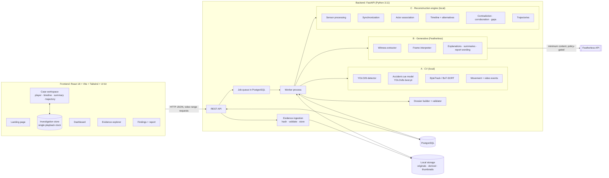
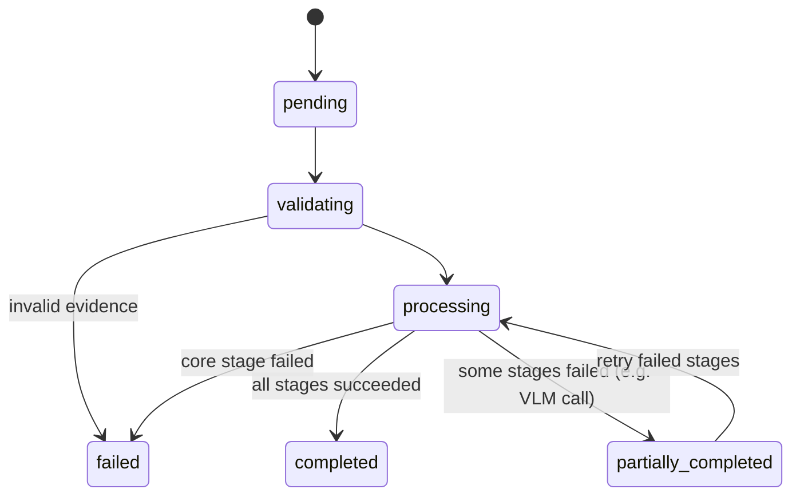

# ARCHITECTURE

Version 3 (master prompt of 2026-10-30). Supersedes `archive/SYSTEM_ARCHITECTURE.md`. Component-level detail remains in the supporting documents listed in §12, subject to the v3 decisions in §11.

## 1. What we are building

A multi-source accident forensics workspace. It turns dashcam and CCTV footage, witness statements, and sensor records into one synchronized, traceable reconstruction: timeline, contradictions, corroborations, gaps, 2D trajectories, alternative scenarios, and an investigation dossier. It is an investigation aid and never assigns fault.

## 2. Three kinds of intelligence

| Kind | Where it runs | Responsibilities | Never does |
|---|---|---|---|
| **A. Computer vision** | Locally (CPU or Apple MPS), pretrained weights | Vehicle and pedestrian detection, accident visual cues, tracking, movement features, frame-level observations | Decide meaning, time alignment, or identity across cameras |
| **B. Generative AI** | Featherless API (hosted) | Witness claim extraction and normalization, selected-frame interpretation, explanation text, report wording, case-grounded Q&A | Produce numbers, timestamps, IDs, positions, or verdicts |
| **C. Deterministic reconstruction** | Locally in Python | Timestamp normalization, clock offsets, sensor maths, event ordering, interval overlap, contradiction rules, correlation, trajectories, uncertainty | Use an LLM for any calculation |

## 3. System diagram

## 4. Technology decisions

| Area | Decision | Reason |
|---|---|---|
| Frontend | React 18, Vite, JavaScript, Tailwind 3.4, Framer Motion, React Router, lucide-react, **our UI starter kit** (`sanjivinsmoke95/ui-kit`) | Matches the prompt and the kit, which is built on the same stack |
| Charts | UI kit SVG charts (`LineChart`, `Sparkline`, `GapChart`, `ActivityTimeline`); **no Recharts unless a kit chart cannot do the job** | Avoid a second visual system |
| Trajectory view | Custom SVG component (`TrajectoryViewer`) | A few dozen tracks; SVG gives hit-testing and crisp scaling without a new library |
| Video overlays | Canvas layer over a native `<video>` | Boxes redraw per frame without React re-renders |
| Client state | A small store (Zustand, MIT) holding one playback clock and selections; components subscribe to slices | Single source of truth; avoids re-render storms |
| Backend | Python 3.11, FastAPI, Pydantic v2, SQLAlchemy 2 + Alembic, PostgreSQL 16 (Docker) | Prompt stack |
| Video | FFmpeg/ffprobe, OpenCV | Metadata, PTS, frame sampling, thumbnails, browser-friendly transcodes |
| Detector | **Ultralytics YOLO26s** default (YOLO26n on CPU-only machines) | Current Ultralytics family; fastest measured option on this Mac (MODEL_SELECTION) |
| Accident cue | Existing **YOLOv8s `best.pt`** (single class `Accident`) | Required starting point; used only as a weak visual cue (MODEL_SELECTION §3) |
| Tracking | **ByteTrack** (CCTV) and **BoT-SORT** with camera-motion compensation (dashcam) from `roboflow/trackers` (Apache-2.0), run on stored detections | Phase 5 change: detector-independent, so tracking can be re-run and evaluated on its own; ships a TrackEval-port evaluator |
| LLM/VLM | Featherless: `Qwen/Qwen3-14B` (text), `Qwen/Qwen3-VL-8B-Instruct` (vision), `Qwen/Qwen3-32B` (report wording) | Verified in the model catalogue; live calls still to be tested |
| Jobs | PostgreSQL-backed job table + one worker process; **no Redis/Celery** in v1 | Enough for one demo machine; `JobRunner` interface allows swapping later |
| Storage | Local disk: `originals/` (read-only, content-addressed), `derived/`, `thumbnails/`; paths and hashes in PostgreSQL | Prompt requirement |

Licence note: Ultralytics (YOLO26, YOLOv8, built-in trackers) is **AGPL-3.0**. That is acceptable for an open-source hackathon submission. The detector and tracker sit behind interfaces, so an Apache-2.0 stack (RF-DETR + `roboflow/trackers`, benchmarked in `research/phase2_benchmark/`) can replace them.

## 5. Backend modules

| Module | Responsibility | Spec |
|---|---|---|
| `cases`, `evidence` | Cases, uploads, hashing, validation, provenance, original/derived separation | SECURITY_AND_EVIDENCE_INTEGRITY |
| `video` | Metadata, sampling (2–5 fps default), detection, accident cue, tracking, thumbnails, movement features, candidate events | VIDEO_PROCESSING_ARCHITECTURE |
| `witness` | Text/TXT/PDF intake, claim extraction, span verification, time expressions | WITNESS_PROCESSING_ARCHITECTURE |
| `sensors` | Column mapping, units, gaps, spikes, heading changes, GPS patterns | SENSOR_PROCESSING_ARCHITECTURE |
| `sync` | Clock offsets, timezones, frame↔time, investigator offsets, uncertainty | SYNCHRONIZATION_ARCHITECTURE |
| `engine` | Events, ordering, actor association, contradiction, corroboration, gaps, alternative scenarios | INCIDENT_RECONSTRUCTION_ENGINE, CONTRADICTION_DETECTION |
| `trajectory` | Image-space trajectories; world-space only with calibration or GPS | TRAJECTORY_RECONSTRUCTION |
| `summaries` | Per-event incident summaries, generated once at analysis time and stored | §7 |
| `report` | 16-section dossier, validator, PDF export | INVESTIGATION_SUMMARY |
| `llm` | Featherless client: policy gate, cache, limiter, retries, ledger, Pydantic validation | MODEL_SELECTION |
| `jobs` | Job states, stage DAG, partial results | API_DESIGN |

## 6. Processing pipeline and job states

Stage order per case: ingest → validate → video (metadata → frames → detect → accident cue → track → movement → events) ∥ witness extraction ∥ sensor processing → synchronization → actor association → timeline + alternatives → contradiction/corroboration/gaps → trajectories → incident summaries → findings. A failed Featherless call marks only its stage failed. Processed video evidence is kept, and the job ends `partially_completed`.

## 7. Incident summaries (analysis time, not playback time)

For each timeline event (and each event cluster), the worker stores an `event_summary` record with five separate parts:
1. direct observations,
2. model detections (with model IDs and confidences),
3. witness claims (verbatim spans),
4. sensor observations (rows),
5. inferences (rule, premises, alternatives).

Plus involved actors, evidence references, review status, uncertainty reasons, and open questions. Sentences come from templates; the optional LLM wording pass is validated so it cannot change IDs, numbers, or times. The frontend fetches summaries by event ID. **No LLM call happens during playback.**

## 8. Frontend synchronization model

- One store: `currentTimeMs` (case time), `activeSourceId`, `activeEventId`, `selectedActorId`, `selectedEvidenceId`, `isPlaying`, `playbackRate`, `overlaySettings`, `scenarioId`, plus `seekRequest {id, timeMs}`.
- **During playback the `<video>` element is the clock.** A `requestAnimationFrame` loop reads `video.currentTime`, maps it to case time through the source's clock offset, and writes `currentTimeMs`. Only the playhead and the overlay canvas subscribe at frame rate. `activeEventId` is derived and changes only when the time crosses an event interval boundary, so summary panels do not re-render per frame.
- **User actions issue seek requests** with incrementing IDs. The player applies only the latest request (latest-wins), which prevents races from rapid clicks.
- Mapping between video time and case time always goes through the backend-provided clock offset for that source. If a source is unsynchronized, the UI says so instead of aligning it.

## 9. Alternative reconstructions

A `reconstruction_scenario` is a named set of assumptions:
- a clock offset choice for an unsynchronized source;
- an actor-identity choice (track 3 = Vehicle A, or track 5 = Vehicle A);
- the treatment of a missing interval;
- the interpretation of an ambiguous event.

The engine recomputes ordering, contradictions, and trajectories per scenario. The UI switches between scenarios and shows what differs. The baseline scenario uses only verified assumptions.

## 10. Security and evidence integrity (summary)

File type and size validation, safe filenames, no path traversal (storage paths are generated by us, never taken from user input), SHA-256 at ingest, read-only originals, derived files separate, append-only processing logs and model-run ledger, and backend-only Featherless calls. A per-case external-inference policy controls whether frames or statements may be sent, and only minimum content (selected frames, one statement) is sent. Details: SECURITY_AND_EVIDENCE_INTEGRITY.md.

## 11. v3 decisions that override earlier documents

| Topic | Earlier | Now |
|---|---|---|
| Detector | RF-DETR recommended (Phase 2) | **Ultralytics YOLO26s/n** per master prompt and to share one stack with the accident model; RF-DETR kept as licence fallback |
| Generated MP4 reconstruction video | Mandatory (previous spec) | **Deferred to P2**: the interactive 2D trajectory view is the reconstruction. Design kept in `archive/RECONSTRUCTION_VIDEO_ARCHITECTURE.md` |
| Event categories | observation / reported_observation / inference | **Four categories**: `direct_observation`, `machine_detection`, `witness_claim`, `inference` (EVENT_SCHEMA v3) |
| API doc | API_SPECIFICATION.md | **API_DESIGN.md** |
| Hardware doc | HARDWARE_AND_DEPLOYMENT.md | **HARDWARE_AND_COMPUTE_PLAN.md** |
| Dataset research | DATASET_RESEARCH.md | **DATA_SOURCES.md** |
| Sampling | Analysis rate ~10 fps | **2–5 fps default**, configurable, with full-rate reprocessing of selected intervals |
| Frontend | Last phase only | Still after backend phases, but a full UI plan now exists (UI_* documents) |

## 12. Document map

Required set: ARCHITECTURE, DATA_SOURCES, DATASET_COMPATIBILITY, DATASET_ACQUISITION_PLAN, MODEL_SELECTION, EVENT_SCHEMA, EVALUATION_PLAN, DEMO_SCENARIOS, DATABASE_SCHEMA, API_DESIGN, IMPLEMENTATION_ROADMAP, HARDWARE_AND_COMPUTE_PLAN.
UI set: UI_STARTER_KIT_AUDIT, UI_DESIGN_SYSTEM, UI_IMPLEMENTATION_PLAN.
Supporting detail: VIDEO/WITNESS/SENSOR_PROCESSING_ARCHITECTURE, SYNCHRONIZATION_ARCHITECTURE, INCIDENT_RECONSTRUCTION_ENGINE, CONTRADICTION_DETECTION, TRAJECTORY_RECONSTRUCTION, INVESTIGATION_SUMMARY, SECURITY_AND_EVIDENCE_INTEGRITY, MODEL_REPOSITORY_ANALYSIS, MODEL_COMPATIBILITY, DATA_ORGANIZATION, PRODUCT_DEFINITION, FUNCTIONAL_REQUIREMENTS, MODULE_SPECIFICATIONS, DATA_FLOW, RISKS_AND_LIMITATIONS.
