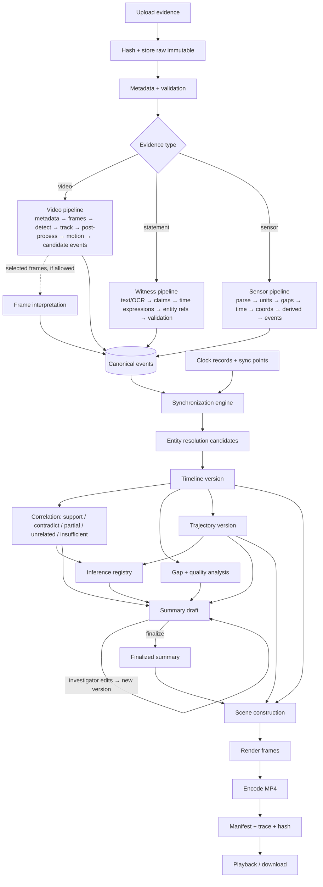

# DATA_FLOW

Version 2.

## 1. End-to-end flow



## 2. Stage contracts

| # | Stage | Inputs | Outputs | Depends on | Failure handling |
|---|---|---|---|---|---|
| 1 | Ingest | File, case, declared source type | Evidence item, raw file, audit entry | — | Duplicate → link; truncated → invalid, kept |
| 2 | Validate | Evidence item | Validation findings, status | 1 | Invalid items stay in the case and are listed in the summary |
| 3 | Video pipeline | Valid video | Frame index, quality, detections, tracks, motion features, candidate events | 2 | Partial decode → process the readable range; zero detections recorded |
| 4 | Witness pipeline | Valid statement | Statement text, sentences, claims, time expressions | 2, `llm` (if allowed) | Policy off → stored text only, claims "not extracted"; invalid output → failed extraction recorded |
| 5 | Sensor pipeline | Valid sensor file + adapter | Normalized records, gaps, sensor events | 2 | Undeclared units → blocked until declared |
| 6 | Frame interpretation (optional) | Selected frames, questions | Scene observations with frame refs | 3, policy | Skipped when policy disallows; recorded |
| 7 | Normalization | Outputs of 3–6 | Canonical events (source time kept) | 3–6 | Schema violations rejected and logged |
| 8 | Synchronization | Clock records, sync points, events | Sync groups, offsets with uncertainty, normalized intervals | 7 | No basis → unsynchronized group |
| 9 | Entity resolution | Tracks, streams, claims | Entities, candidate links with reasons | 7, 8 | Ambiguity → candidates only |
| 10 | Timeline | Normalized events, links | Timeline version: relations, alternatives | 8, 9 | Undetermined order → kept as alternatives |
| 11 | Correlation, contradiction, corroboration | Timeline, links | Correlation records | 10 | Insufficient time or identity basis → "insufficient" |
| 12 | Gaps and quality | All of the above | Gap records, recommendations | 3–11 | — |
| 13 | Trajectories | Tracks, calibration, GPS, sensors, sync | Trajectory version | 8–10 | No calibration → image-space only |
| 14 | Inference | Correlations, trajectories | Inference records with premises and alternatives | 11, 13 | Rule preconditions unmet → no inference |
| 15 | Summary | All records | Summary version (draft) | 10–14 | Missing stages → stated in limitations |
| 16 | Finalize | Investigator action | Finalized summary | 15 | — |
| 17 | Reconstruction video | Finalized summary, timeline and trajectory versions, scene geometry | MP4, manifest, trace | 16 | Render failure → job failed; summary unaffected |
| 18 | Staleness | Any new upstream version | Stale flags, change diff | — | — |

## 3. Original playback flow

```
GET video (range) ─▶ player
player time t_v ─▶ /playback/map?evidence=..&video_time=t_v ─▶ case time interval (via sync record) ─▶ selected events, trajectory positions
event click ─▶ /events/{id}/seek ─▶ {evidence_id, video_time, frame_no, supporting frames}
overlays ─▶ /videos/{id}/overlays?from=..&to=.. ─▶ boxes, track IDs, event markers for that window
```

When a video belongs to an unsynchronized group, the mapping returns `null` for case time and says why.

## 4. Traceability chain

```
summary sentence / video marker
   └─▶ finding (correlation | gap | inference | trajectory segment)
         └─▶ canonical events
               └─▶ source references (video frames a–b | sensor rows a–b | statement sentence k, chars s–e | OCR region)
                     └─▶ raw evidence item (SHA-256)
```

Every hop is a stored foreign key or a stored reference that is validated at write time.

## 5. Data at rest per stage

| Stage | Persisted |
|---|---|
| 1–2 | evidence items, metadata, validation findings, audit entries |
| 3 | frame index, quality, detections, tracks, motion features, events |
| 4 | statement text, sentences, claims, model ledger |
| 5 | sensor records, gaps, events |
| 6 | scene observations, model ledger |
| 8–9 | clock records, sync groups, entity candidates and links |
| 10–14 | timeline versions, correlation records, gaps, trajectory versions, inferences |
| 15–16 | summary versions, finalization records |
| 17–18 | video artifacts, manifests, traces, stale flags |
