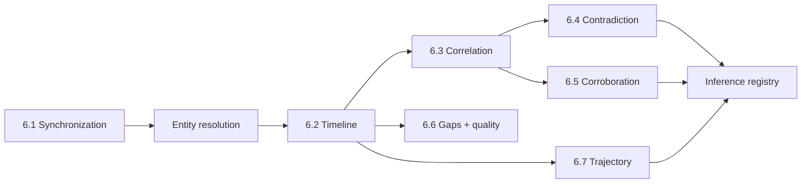

# INCIDENT_RECONSTRUCTION_ENGINE

Version 2. The central system. Deterministic Python only; LLMs never decide order, time, identity, or position. The engine reads canonical events, clock records, entities, and calibrations, and writes versioned reconstruction records.

## 1. Submodules

6.1 is specified in SYNCHRONIZATION_ARCHITECTURE.md, 6.4 in CONTRADICTION_DETECTION.md, and 6.7 in TRAJECTORY_RECONSTRUCTION.md. This document covers entity resolution, 6.2, 6.3, 6.5, 6.6, and the inference registry.

## 2. Entity resolution

- **Inputs:** tracks (per camera), sensor streams (with mounting entity), claim descriptions, investigator-entered entities.
- **Deterministic auto-links (confirmed):** sensor stream mounted on a declared entity; dashcam mounted on the ego vehicle; the same track ID within one video; simulator actor IDs in synthetic scenarios.
- **Candidate links (not merged):** cross-camera track matches (time overlap + zone handoff + appearance attributes), claim descriptions ↔ tracks (type, colour from frame interpretation, role, relative position), track ↔ sensor (motion profile similarity in the same sync group).
- **Each candidate stores** `basis` (list of reasons with values) and `status` (`candidate`, `confirmed`, `rejected`). Investigator decisions are audited.
- **Downstream rule:** contradiction rules require `confirmed` links by default. Candidate-only links produce `insufficient` outcomes with the reason "identity not confirmed". This can be relaxed per rule only with an explicit flag shown in the output.

## 3. Timeline reconstruction (6.2)

**Representation.** Events are intervals with uncertain boundaries. For two events A and B in the same sync group:
- `A before B` if `A.end.latest < B.start.earliest` (or, for point events, `A.latest < B.earliest`);
- `A after B` symmetric;
- `overlaps` if their certain extents intersect;
- `undetermined` otherwise (uncertain boundaries allow both orders).
Events in different sync groups are always `undetermined`.

**Ordering output.** Each event gets a rank range `[rank_lower, rank_upper]`, computed from the partial order: the number of events certainly before it, and the number not certainly after it. Equal rank ranges are not forced into an order.

**Alternative orderings.** For small ambiguous clusters (≤ a configurable size), the engine enumerates the linear orderings consistent with the partial order and stores them. For larger clusters it stores the partial order only and reports "N events with undetermined order".

**Corrections.** Investigator corrections (move a boundary, reject an event, add a manual event, confirm or reject a link or sync point) are stored as `timeline_corrections`. They produce a new `timeline_version` and never alter raw evidence or earlier versions. Each version records its parent, its input hashes, and the reason.

**Links to evidence.** Every timeline entry is an event ID, so it resolves to source references through provenance.

## 4. Evidence correlation (6.3)

Candidate pairs are events of compatible types (by a type-compatibility table), concerning the same confirmed entity or the same scene-level attribute, in the same sync group, with overlapping or adjacent time intervals.

Each pair is classified:

| Class | Meaning |
|---|---|
| `supporting` | Same event type and compatible attributes within tolerances |
| `partially_supporting` | Agreement on some attributes, others not comparable (e.g., timing matches, direction not observable) |
| `contradicting` | A contradiction rule fires (CONTRADICTION_DETECTION.md) |
| `unrelated` | Different entities or non-overlapping time beyond tolerance |
| `insufficient` | A comparison is wanted, but identity, time, or frame of reference is too uncertain |

Every record stores the rule, the compared values, tolerances, uncertainty used, independence assessment, and a template explanation.

## 5. Corroboration (6.5)

A finding is corroborated by **independent** sources only.

| Not independent | Reason |
|---|---|
| A video event and a frame-interpretation event from the same video | Same evidence item |
| Two events derived from the same track | Same measurement |
| A sensor event and a speed derived from the same sensor | Derived |
| Two statements by the same witness | Same person |
| A re-encoded copy of a video (same content hash after decode, or declared duplicate) | Duplicate |
| Inferences | Never evidence |

Possibly dependent (flagged, still counted separately with a caveat): two witnesses who may have spoken to each other (from investigator notes).

Output: corroboration records listing each independent source, its limitations (quality, timestamp reliability), and the independence reasoning.

## 6. Gap and quality analysis (6.6)

| Gap type | Detection |
|---|---|
| Missing video interval | PTS gaps; time ranges covered by no video in the sync group |
| Low frame rate | Measured rate below a threshold relative to event duration |
| Motion blur / poor lighting | Frame quality metrics |
| Occlusion | Track post-processing flags |
| Missing sensor samples | Sensor gaps |
| Clock inconsistency | Sync-cycle residuals; conflicting clock records |
| Tracking fragmentation | Track gap counts, candidate continuations |
| Uncertain vehicle identity | Entities with only candidate links |
| Missing camera calibration | Cameras without calibration (blocks metric trajectories) |
| Unsupported event claims | Claims with no comparable evidence (untestable) |
| Unsynchronized sources | Groups with no edge |

Each gap produces a **recommendation** from a fixed table (e.g., "request CCTV from the north approach for 12.0–14.5 s", "obtain the vehicle's event data recorder", "measure four ground reference points for camera 2 calibration", "confirm CCTV clock offset"). Recommendations are templates filled with gap details, never free-form model text.

## 7. Inference registry

Inferences are produced only by registered rules. Each rule declares:
- an ID and description;
- required premise types and conditions (e.g., `vehicle_slowing` observation + `hard_braking` sensor event within 0.5 s in the same group for the same confirmed entity);
- the support level computed from premise quality;
- **mandatory alternatives** (e.g., "braking for signal", "braking for an unrelated hazard").

Outputs are `inference` events with premises and alternatives. Inferences are never premises for other inferences in v1, and never counted as corroboration.

## 8. Versioning and outputs
`timeline_versions`, `timeline_entries`, `timeline_relations`, `correlation_records`, `gap_records`, `inferences`, `trajectory_versions`. Each run records its input versions in `artifact_dependencies`, so downstream summaries and videos can be marked stale.

## 9. Evaluation separation
The engine is evaluated with **oracle inputs** (ground-truth tracks and events injected through the same interfaces) and separately with **model inputs** (real detector/tracker/LLM outputs). This isolates engine logic errors from model errors (EVALUATION_PLAN).
