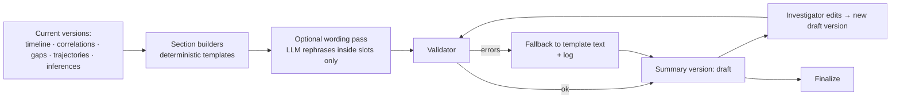

# INVESTIGATION_SUMMARY

Version 2. The summary is **assembled from validated structured records**. No LLM writes the narrative on its own.

## 1. Sections and their sources

| # | Section | Built from | Notes |
|---|---|---|---|
| 1 | Incident overview | Case, evidence counts, sync groups, time span covered | Template; no causal statements |
| 2 | Evidence inventory | `evidence_items` with hash, type, source, real/synthetic, validation status | Lists invalid items too |
| 3 | Evidence quality assessment | Quality reasons per item | Per item, categorical, with reasons |
| 4 | Reconstructed chronological timeline | Current timeline version: entries, relations, alternative orderings, unsynchronized groups | Each entry marked Observed / Reported / Inferred |
| 5 | Vehicle identities and limitations | Entities, confirmed links, candidate links, rejected links | States what is not confirmed |
| 6 | Vehicle movement and trajectories | Trajectory version: level, frame, uncertainty, gaps | States "not to scale" where applicable |
| 7 | Candidate collision interval/location | Collision region records | Or "not determinable", with the reason |
| 8 | Corroborating findings | `supporting` and `partially_supporting` correlation records, with independence | |
| 9 | Contradictions | `contradicting` records (clear and marginal listed separately), with benign explanations | No verdict on which source is right |
| 10 | Missing evidence and gaps | Gap records + recommendations | |
| 11 | Direct observations | Events with `observation` | Grouped by source |
| 12 | Inferences | Inference events with premises, support level, alternatives | Always "possible", never stated as fact |
| 13 | Unresolved questions | `insufficient` correlations, undetermined orderings, untestable claims, unconfirmed identities | |
| 14 | Confidence and uncertainty assessments | Separate assessment blocks | No combined score |
| 15 | Evidence references | Reference table for every cited ID → source sub-unit | |
| 16 | System limitations | Static limitations + case-specific ones (stages skipped or failed, no calibration, synthetic data, external inference disabled) | |

## 2. Generation pipeline

- **Templates:** each sentence type has a template with typed slots (IDs, values, intervals). Example: "{source_label} shows {entity_label} {event_phrase} between {t_from} and {t_to} (frames {f_a}–{f_b})."
- **Optional wording pass:** the LLM receives slot-filled sentences and may improve fluency. It may not add, remove, or change IDs, numbers, intervals, or hedges. The validator compares slot values before and after; any change rejects the rewrite.

## 3. Validator rules
1. Every sentence that states a finding cites at least one record ID, and every cited ID resolves.
2. Quoted witness text matches the stored verbatim span.
3. Numbers and intervals match the referenced records.
4. Banned language: fault, guilt, liability, "caused by", "responsible for", "proves", "definitely", and "was negligent", plus equivalents in a maintained list. Violations block finalization.
5. Inferences appear only in section 12 (or referenced from 4 with an "Inferred" marker), always with "possible" or "may" and alternatives.
6. Synthetic data is declared in sections 1, 2, and 16 when present.
7. Stages that did not run are declared in section 16.

## 4. Versions and finalization
- Each generation or edit creates a new `summary_version` with its parent, input versions, and edit reason. Previous versions are kept (`superseded`).
- Investigator edits are structured (change a section's text block, add a note, mark a finding as reviewed). Free-text notes are labelled "Investigator note" and are not machine findings.
- **Finalization** requires zero validator errors, records actor and time, and freezes the version. Only finalized versions can feed the reconstruction video.
- If any input version changes after finalization, the summary is marked stale and a new draft is required.

## 5. Exports
JSON (complete, machine-readable), Markdown, and PDF. Each export includes the summary version, the input versions, a hash of the content, and the reference table.

## 6. Optional case assistant
- Answers questions using **only** the current case's records, retrieved by deterministic queries and text search over stored records.
- Every answer cites record IDs; uncited sentences are removed by the validator.
- If the records do not support an answer: "The case records do not contain evidence for this."
- No access to ground truth, other cases, or general web knowledge.
- Skipped when the case disallows external inference.
