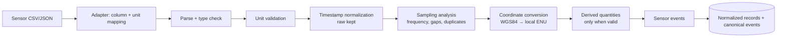

# SENSOR_PROCESSING_ARCHITECTURE

Version 2. Pandas, NumPy, Python `datetime`/`zoneinfo`, and PyProj or GeographicLib for coordinates.

## 1. Pipeline

## 2. Canonical sensor fields

| Field | Unit | Notes |
|---|---|---|
| `t` | source unit → seconds | Raw value kept in `t_raw` with its unit |
| `lat`, `lon`, `alt` | degrees, metres | WGS84 assumed only when declared |
| `gps_accuracy` | metres | If provided (HDOP or horizontal accuracy) |
| `speed` | m/s | Declared source unit converted |
| `heading` | degrees, 0 = north, clockwise | Convention declared by the adapter |
| `accel_x/y/z` | m/s² | Axis convention declared (vehicle frame) |
| `gyro_x/y/z` | rad/s | |
| `orientation` | roll/pitch/yaw in degrees, or quaternion | |
| `collision` | boolean or intensity | Source-specific (e.g., CARLA collision event) |
| `frame` | int | CARLA frame ID when present |

## 3. Adapters
Each sensor source needs an adapter declaring column mapping, units, axis conventions, timestamp format and epoch, timezone, and source clock (`simulation`, `device_utc`, `device_local`, `relative`). Undeclared units **block** processing until declared. Adapters ship for CARLA exports and for BDD100K info files (the latter only if Phase 3 verifies the format).

## 4. Timestamps
- `t_raw` is kept exactly. Normalized source time `t_src_s` is seconds in the source's own clock.
- Mapping to case time is the synchronization engine's job. The sensor pipeline never assumes the sensor clock equals any video clock.
- Timezone handling uses IANA zones from the adapter or evidence metadata; ambiguous local times (DST transitions) are flagged.
- CARLA: `timestamp` (simulation seconds) and `frame` are both kept; the clock is `simulation`.

## 5. Sampling analysis
- Nominal rate from the adapter; measured rate from median interval.
- Gaps: an interval above a multiple of the median (configurable) creates a `sensor_gap` record and event.
- Duplicate or non-monotonic timestamps are flagged and kept in raw form; they are excluded from derived calculations.
- The sampling frequency is preserved; no resampling of raw records. Any resampled view is a separate derived product.

## 6. Coordinates
- WGS84 to a local ENU frame (metres) around a case origin, using PyProj or GeographicLib. The origin and method are stored.
- Position uncertainty is taken from `gps_accuracy` if present; otherwise marked `unknown` (no invented default presented as measured).

## 7. Derived quantities (validity conditions)

| Quantity | Allowed when | Method recorded |
|---|---|---|
| Acceleration from speed | Rate ≥ configured minimum, no gap in window | Smoothed finite difference; window size |
| Speed from GPS | Accuracy known and adequate, no gap | Geodesic distance / dt with smoothing |
| Heading from GPS | Speed above minimum (heading undefined when stopped) | Bearing between smoothed points |
| Dead-reckoned path | Speed and heading available; short horizon only | Integration; drift warning attached |

## 8. Sensor events (rule-based, each with `rule_id`)
`hard_braking` (longitudinal deceleration beyond threshold for ≥ duration), `speed_change`, `stop`, `heading_change`, `collision_flag` (source-provided), `sensor_gap`. All are `observation` with row references.

## 9. Synchronization rule
A sensor file and a video belong to the same sync group **only** through a recorded synchronization basis: shared simulation clock (CARLA), documented shared device clock, known offset, frame correspondence, or a verified sync point. Similar-looking timestamps are not a basis. Sensor records from unrelated recordings are never combined with a video (DATASET_COMPATIBILITY.md).

## 10. Failure modes
Unknown units (blocked), unknown axis conventions (accelerations not used directionally), non-monotonic time (flag and exclude), GPS drift (accuracy-based uncertainty), and missing timezone for local timestamps (unsynchronized until resolved).
