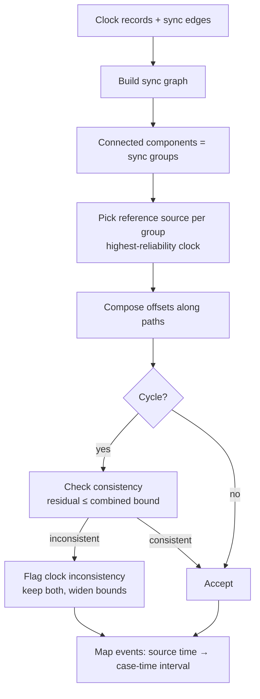

# SYNCHRONIZATION_ARCHITECTURE

Version 2. Principle: **two clocks are synchronized only if a recorded basis says so.** Similar timestamps are not a basis.

## 1. Concepts

| Concept | Meaning |
|---|---|
| Source clock | The time axis of one evidence item (video PTS, sensor `t_src_s`, witness phrase) |
| Clock record | What is known about a source clock: absolute start (if any), timezone, offset, drift, basis, bound |
| Sync edge | A stated relation between two source clocks: `t_b = t_a + offset ± bound`, with a basis |
| Sync group | Sources connected by sync edges; events in a group share a case time axis |
| Case time | Seconds on the group's reference clock (one reference source per group) |
| Unsynchronized | A source with no edge to the group; its events keep their source time only |

## 2. Accepted synchronization bases

| Basis | Example | Default bound | Auto-applied? |
|---|---|---|---|
| `simulation_clock` | CARLA camera and sensors from one run | Frame period (plus documented camera delivery delay handling) | Yes (from manifest) |
| `frame_correspondence` | Dataset documents frame ↔ trajectory row mapping | Frame period | Yes, if documented in the manifest |
| `embedded_utc` + `declared_by_investigator` | Both devices' clocks declared trustworthy with known offsets | Declared bound | Only after declaration |
| `known_offset` | Investigator measured the offset (e.g., CCTV clock 37 s fast) | Declared bound | Yes, once entered |
| `manual_sync_point` | Investigator marks the same instant in two sources (flash, impact) | Frame period of the coarser source + stated marking error | Yes, once verified |
| `anchor_proposal` | System suggests impact in video ↔ IMU spike | Computed | **No**: proposal only until confirmed |
| `witness_relative` | "just before the crash" | Phrase window | Places a claim relative to an anchor event in the same group; never creates an edge between devices |

Embedded metadata times (container `creation_time`, on-screen clocks) are recorded as **claimed** absolute times. They become a basis only when declared or cross-checked.

## 3. Algorithm

- **Composition:** offsets add; bounds add linearly (conservative), or in quadrature when edges are documented as independent with Gaussian error (the choice is configuration, recorded).
- **Drift:** applied only when known; otherwise not modelled, and long recordings get a bound note.
- **Interval mapping:** an event's `[earliest, latest]` in source time maps to case time widened by the path bound.
- **Multiple paths:** the tightest consistent path is used; alternatives are kept in `sync_groups.composition`.

## 4. Anchor proposals (assistive, not authoritative)
The engine may propose edges by matching candidate anchors across sources: video `potential_collision_interval` peak, IMU spike, sensor `collision_flag`, CCTV event. A proposal includes both references, the estimated offset, residuals, and alternatives. It is stored in `sync_points` with status `proposed` and **does not change any timeline until an investigator confirms it** (SYNC-02). For synthetic scenarios with a documented shared clock, proposals are only used to test the proposal mechanism against ground truth.

## 5. Timezones and wall-clock times
- IANA timezone per source where known. Wall-clock times are converted to UTC before comparison.
- Missing timezone: wall-clock values are kept, and comparison with other sources is impossible until resolved, so the source stays unsynchronized.
- DST-ambiguous times are flagged.

## 6. Missing timestamps
- Video with PTS but no absolute start: internal ordering is valid; cross-source alignment needs an edge.
- Video with broken PTS: frame number × nominal rate, with widened bounds and a quality flag.
- Sensor with relative times only: same as above.
- Witness with no time: untimed claim; excluded from time-based comparison.

## 7. Outputs
`clock_records`, `sync_points`, `sync_groups` (versioned), normalized event intervals with `sync_group_id`, and gap records for clock inconsistencies.

## 8. Consequences for downstream stages
- The timeline orders events only **within** a sync group. Across groups the relation is `undetermined`.
- Contradiction rules that depend on time require both events in the same group and a time bound under the rule's threshold. Otherwise the outcome is `insufficient`.
- The summary lists every group, its basis, and its bound.
- The reconstruction video renders only one sync group on its clock. Other groups appear as an "unsynchronized evidence" note, not as positioned events.

## 9. Testing
CARLA scenarios with **injected known offsets** between sources (timestamp absolute error, EVALUATION_PLAN), cycle-inconsistency cases, timezone and DST unit tests, and a property test: no event in an unsynchronized source receives case time.
