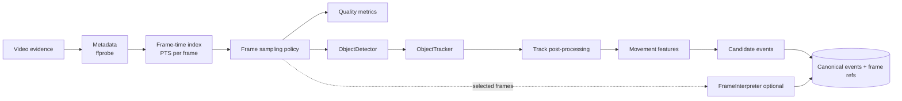

# VIDEO_PROCESSING_ARCHITECTURE

Version 2. Applies to dashcam and CCTV. Pretrained components only; checkpoint choice is made in Phase 2 (MODEL_SELECTION, MODEL_REPOSITORY_ANALYSIS).

## 1. Pipeline

## 2. Stages

### 2.1 Metadata
- **Tool:** ffprobe.
- **Stored:** container, codec, resolution, rotation, nominal and average frame rate, duration, frame count, per-frame PTS, `creation_time` tags, timecode if present.
- **Checks:** monotonic PTS; variable frame rate detection; mismatch between nominal and measured rate; truncated streams.
- Embedded times are recorded as **claimed recording times** with basis `embedded_metadata`. They are never trusted as synchronized without a clock record (SYNCHRONIZATION_ARCHITECTURE.md).

### 2.2 Frame-time index and sampling
- Every frame keeps `frame_no` and `pts_s`. All later records refer to these, not to sampled indices.
- **Sampling policy** (CPU-only hardware): process at a configured analysis rate (e.g., 10 fps for tracking, keyframes for interpretation) and resolution (detector input size). The policy is stored with the outputs and is part of `params_hash`.
- Frames skipped by sampling are not "missing evidence". Frames missing from the stream are, and both are recorded separately.

### 2.3 Quality metrics
Per sampled frame: Laplacian variance (blur), mean and percentile brightness (lighting), duplicated or dropped frame flags from PTS gaps. Aggregated into evidence-quality reasons (EVENT_SCHEMA §6) and into gap analysis.

### 2.4 Detection (`ObjectDetector`)
- **Classes kept:** car, truck, bus, motorcycle, bicycle, person (pedestrian). Class mapping from the detector's label set is configuration, stored with outputs.
- **Each detection stores:** frame ID, video ID, video timestamp (PTS), box, class, confidence, model/checkpoint ID, parameters hash.
- **Thresholds:** a low storage threshold (keep weak detections for tracking) and a higher display threshold. Both are recorded.

### 2.5 Tracking (`ObjectTracker`)
- **Default:** ByteTrack. **Alternative:** BoT-SORT for moving cameras. The choice is measured in Phase 2/evaluation.
- **Each track stores:** track ID, detection references, first and last observed frame, box sequence, gaps (frame ranges with no matched detection), reliability metadata.
- The tracker's frame rate parameter is set to the **analysis rate**, not the source rate.

### 2.6 Track post-processing
- Keep incomplete tracks; never delete short tracks silently (they are flagged `short`).
- Record occlusion candidates: box overlap with another track before a gap; box at the image border; abrupt size change.
- Record ID-switch risk: two tracks with crossing paths and similar appearance; track ending and another starting nearby within a short interval (stored as a **candidate continuation**, not merged).
- **No interpolation is stored as observed.** If interpolation is needed for visualization, it is a separate, labelled segment.

### 2.7 Movement features
Computed in **image space** by default. Ground-plane values are computed only with a valid calibration (TRAJECTORY_RECONSTRUCTION.md).

| Feature | Image-space definition | Caveat |
|---|---|---|
| Position change | Bottom-centre point displacement per second | Not metres |
| Direction change | Change in smoothed motion angle beyond threshold over window | For dashcams, relative to the moving camera |
| Slowing / stopping | Decreasing displacement rate; for dashcams, combined with box-scale rate | Ego motion confounds; flagged unless ego speed is known |
| Sustained low movement | Displacement rate below threshold for ≥ N s | |
| Region entry and exit | Track point enters or leaves a configured polygon (e.g., an intersection zone on CCTV) | Requires zone definition per camera |
| Interaction | Two tracks within a proximity threshold (image or ground plane) | Image proximity ≠ physical proximity |

For dashcams, ego motion is compensated only when ego speed and heading are available from synchronized sensors; otherwise features carry `ego_motion_uncompensated: true`.

### 2.8 Candidate events
Rule-based, each with a `rule_id`, thresholds, and frame references:

`vehicle_entering_intersection` (zone entry, CCTV), `vehicle_direction_change`, `vehicle_slowing`, `vehicle_stopping`, `sustained_low_movement`, `object_leaves_scene`, `potential_interaction`, `potential_collision_interval`.

- `potential_collision_interval` = box overlap or contact-like proximity plus an abrupt motion change. It is **always** a potential event. It can be corroborated by a sensor `collision_flag` or IMU spike in the same sync group, but the video event itself never becomes "collision".
- Every event references the supporting frames (first, last, and peak frame).

### 2.9 Optional frame interpretation
- Frames are selected by rule: the peak frame of each candidate event, plus a small fixed number of context frames.
- Questions come from a fixed list: signal state visible, weather, lighting, visible damage, vehicle colour and type for listed tracks (with box crops).
- Output: `scene_context` observations with frame references and model ID. Never used for time, speed, coordinates, or identity.
- Skipped when the case disallows external inference.

## 3. Low-quality footage behaviour

| Condition | Behaviour |
|---|---|
| Night, rain, blur | Lower detection and tracking assessments; quality reasons recorded; events still extracted with lower reliability |
| Occlusion | Track gaps recorded; candidate continuations kept, not merged |
| Missing frames | Gap records; no events fabricated inside gaps |
| Low frame rate | Thresholds scaled; time bounds widened to frame spacing |
| Uncertain identity | Entity candidates only |

## 4. Outputs and storage

`frame_index`, `detections`, `tracks`, motion feature files (`processed/motion/<evidence>/<params_hash>.parquet`), canonical events, and optional scene observations. All carry `model_id`/`tracker_id`, `params_hash`, `input_hash`.

## 5. Failure modes

Undecodable ranges (processed around and recorded), variable frame rate (PTS-based timing used throughout), extreme resolution (downscaled per policy and recorded), detector or tracker crash (job failed, retryable), zero detections (recorded explicitly).

## 6. Verification hooks

- Detection and tracking metrics against BDD100K labels (Phase 3 subset).
- Event rules against CARLA or other scenario ground truth.
- A test that every event's frame references exist in `frame_index`.
