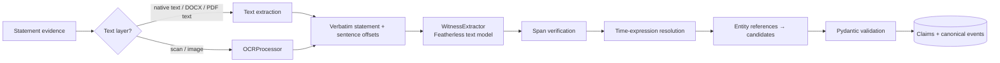

# WITNESS_PROCESSING_ARCHITECTURE

Version 2.

## 1. Pipeline



## 2. Text extraction
- Native text: stored as-is (normalized line endings only, with original bytes kept in the raw store).
- DOCX/PDF: text extraction with page and paragraph references.
- Scans: `OCRProcessor` (PaddleOCR candidate, Phase 2) returns text, boxes, and confidence. Low-confidence tokens are flagged; the statement record keeps `text_source = ocr` and `ocr_confidence`.
- Sentences are split deterministically and stored with character offsets. **The original statement is never discarded or rewritten.**

## 3. Claim extraction
The `WitnessExtractor` is given one statement at a time and returns a list of claim candidates:

```json
{
  "claims": [{
    "sentence_no": 4,
    "verbatim_span": "the white car turned left just before the crash",
    "event_described": "vehicle_turned",
    "vehicle_or_object": {"description": "white car", "role": "other"},
    "action": "turned left",
    "location": {"text": null},
    "time": {"text": "just before the crash", "exactness": "approximate", "anchor": "collision"},
    "hedges": ["I think"],
    "first_hand": true
  }]
}
```

Rules given to the model and enforced in code:
1. `verbatim_span` must be copied exactly from the statement. Code verifies it is a substring of the given sentence; otherwise the claim is rejected.
2. Fields not stated in the text are `null`. The model must not fill gaps.
3. No credibility, truthfulness, blame, or fault fields exist in the schema, so the model cannot produce them.
4. Temperature 0; the prompt and model are versioned; responses are cached.
5. Invalid JSON gets one repair attempt with the validation error, then the extraction is recorded as failed.

## 4. Four separate layers per claim (WIT-05)

| Layer | Stored in | Example |
|---|---|---|
| Explicit statement | `claims.verbatim_text` + offsets | "the white car turned left just before the crash" |
| LLM-normalized interpretation | `claims.normalized` | `{event: vehicle_turned, action: left, time: approx before collision}` |
| Corroboration status | `claims.corroboration_status` (from engine) | `none` / `supported_by:[…]` |
| Contradiction status | `claims.contradiction_status` (from engine) | `contradicted_by:[…]` |

The summary and UI always show the verbatim text next to any normalized interpretation.

## 5. Time expressions
Deterministic resolution after extraction:

| Expression type | Resolution |
|---|---|
| Clock time ("at 6:42 pm") | Wall-clock interval at stated precision (± 30 s for minute precision), converted through the case clock record if one exists |
| Relative to an event ("just before the crash") | Interval relative to the anchor event, with a configurable window per phrase class; anchor resolved only if a matching anchor event exists in the same sync group |
| Duration ("about five seconds later") | Interval with relative tolerance (configurable, recorded) |
| None | `start_time = null`; claim is untimed and cannot take part in time-based comparisons |

Phrase-class windows are configuration, recorded with outputs, and evaluated against synthetic answer keys. They are not claimed to model human perception accurately.

## 6. Entity references
Descriptions ("the white car", "the truck", "the man crossing") become **entity candidates** with basis `description_match` (colour, type, role, relative position). They are matched against entities from video and sensors only as candidates. Confirmation needs either an unambiguous match under explicit rules (a single vehicle of that type in the scene) or investigator confirmation.

## 7. Outputs
`statements`, `statement_sentences`, `claims`, canonical events with `observation_or_inference = reported_observation`, and model-call ledger entries.

## 8. Policy and privacy
- If `allow_external_inference = false`, claim extraction is skipped and recorded. The statement text remains available, and claims can be entered manually with spans (`extraction_method = manual`).
- Witness contact details are not sent to models; only the statement text is sent.

## 9. Failure modes
Low OCR confidence (flag, show original image region), vague or missing times (untimed claims), pronoun ambiguity (actor `null` or candidate list), multi-language statements (out of scope for v1; recorded as unsupported), and model refusal or invalid output (failed extraction, manual path available).

## 10. Evaluation hooks
Claim precision and recall, span validity rate, time-interval coverage against answer keys (EVALUATION_PLAN.md). Synthetic statements are labelled synthetic.

## 11. As built in Phase 6
- Extraction schema (`app/services/witness.py`): `source_text`, `subject`, `action`, `direction`, `location`, `time_description`, `time_exactness`, `certainty` (`reported_as_direct_observation | hedged | hearsay | assumption`), `hedges`. Unknown fields are rejected.
- The model never supplies offsets; code locates the quote (exact substring; repeated quotes map to successive occurrences; unlocatable quotes are rejected).
- Prompt version `witness-claims-v1`; `<statement>` delimiters; instructions inside a statement are ignored by design and, more importantly, cannot alter the schema or inject text that is not in the statement.
- Time expressions are **not** resolved in this phase (needs synchronization): only the phrase and its exactness are stored.
- PDF and OCR statements are not processed yet (text and `.txt` only).
