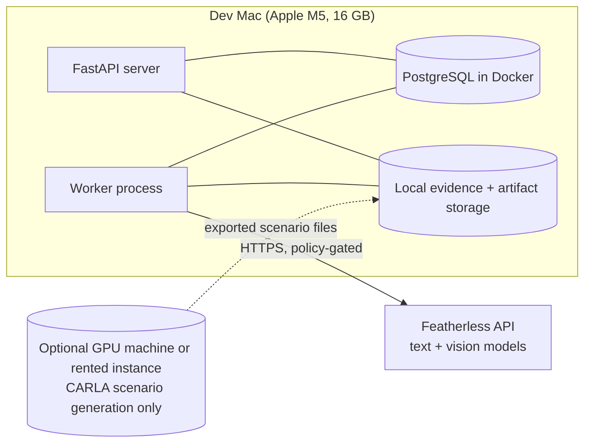

# HARDWARE_AND_DEPLOYMENT

Version 2.

## 1. Known hardware (measured on the development machine, 2026-10-30)

| Item | Value |
|---|---|
| Machine | Apple M5, 16 GB unified memory |
| GPU | Integrated Apple GPU (Metal 4); **no NVIDIA/CUDA GPU** |
| Free disk | About 225 GB |
| Python | 3.9.6 installed (too old; 3.11+ required) |
| FFmpeg | **Not installed** |
| Node | Installed (frontend, last phase) |
| Docker | Installed |

Team statement: no GPUs for training. No training is planned.

## 2. Consequences

1. **Inference only, on CPU or Apple Silicon.** Small pretrained detector checkpoints; PyTorch MPS acceleration may be usable for some models (verify in Phase 2, without assuming).
2. **Processing budget, not real-time:**
   - analysis frame rate below the source rate (e.g., 10 fps for tracking; configurable);
   - detector input size kept small (e.g., 640 px; measured trade-off);
   - frame interpretation only on selected keyframes;
   - one worker by default, to avoid memory pressure.
3. **Hosted inference** (Featherless) for text and vision-language tasks, subject to case policy and budget (about 25 USD; plan type unconfirmed).
4. **CARLA cannot run locally.** Its documentation lists an NVIDIA GPU (8 GB+ VRAM) on Windows 10/11 or Ubuntu 20.04/22.04; macOS is not listed. CARLA is still the preferred controlled-scenario source, so a decision is needed (§4).
5. **Reconstruction rendering** is 2D and CPU-friendly (OpenCV/Pillow + FFmpeg).

No latency figures are claimed. Phase 2 measures detector and tracker throughput on this machine.

## 3. Deployment topology (hackathon)

- One `docker compose` for PostgreSQL; the API and worker run in a Python virtual environment (or a container, optional).
- CARLA, if used, runs **offline** on another machine. Only its exported files (video, sensor CSVs, ground truth, manifest) are transferred, then ingested like any other evidence (with ground truth stored separately).

## 4. CARLA decision options

| Option | What it means | Trade-off |
|---|---|---|
| A. Borrowed NVIDIA PC (Windows/Ubuntu) | A team member or lab machine runs CARLA scripts and exports scenarios | Best fidelity; depends on access |
| B. Rented cloud GPU instance | Short-term instance with CARLA installed | Costs money (not yet estimated); setup time |
| C. No CARLA: deterministic scenario generator | A Python generator produces exact ground-truth trajectories, sensor streams, and simple rendered views | Fully local; **pretrained detectors are not meaningful on rendered sprites**, so model-path evaluation relies on real datasets (BDD100K, NGSIM) and the engine is evaluated with oracle inputs |

The engine and reconstruction video do not depend on CARLA. CARLA affects only how realistic the controlled scenarios are, and whether the model path can be tested on accident-like footage.

## 5. Environment setup (Phase 0, after approval)
- Python 3.11+ (uv or Homebrew), virtual environment, pinned dependencies.
- FFmpeg via Homebrew.
- PostgreSQL via Docker.
- `.env` (not committed): `FEATHERLESS_API_KEY`, `FEATHERLESS_TEXT_MODEL`, `FEATHERLESS_VISION_MODEL`, `DATABASE_URL`, `TRACELINE_DATA_DIR`.
- `.env.example` committed with empty values.

## 6. Storage budget
About 60 GB for datasets and processed data, unless the team agrees otherwise. Processed frames are not kept for whole videos by default; detections and tracks are kept, and frames are re-extracted on demand.

## 7. Demonstration deployment
- Pre-processed demo cases with cached model responses, so the demo does not depend on live API latency.
- A recorded backup of the full workflow.
- Optional: a single-host deployment (the same compose file) on a cloud VM if remote judging requires it.
