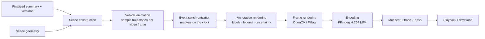

# RECONSTRUCTION_VIDEO_ARCHITECTURE

Version 2. A mandatory core feature: a **deterministic** MP4 rendered from the finalized reconstruction. It is not original evidence and never uses generative video.

## 1. Two playback experiences

| | Original evidence playback | Reconstruction video |
|---|---|---|
| Source | Uploaded footage (byte-identical) | Rendered from finalized records |
| Backend support | Range streaming, overlays, time mapping, event seek (API_SPECIFICATION) | Render job, manifest, trace, stale status |
| Labelling | "Original evidence: <evidence ID>" | Persistent banner: "Generated reconstruction, not original footage" |
| Available | After ingest | After summary finalization |

Original playback behaviour (served by the backend, used by the UI later):
- **Event selection:** `GET /events/{id}/seek` → seek time and supporting frame; overlays highlight the supporting boxes.
- **Manual seek:** `GET /playback/map?video_time=` → case-time interval, active events, and trajectory positions, so the UI can update the selected event and trajectory marker.

## 2. Inputs (all must be versioned and consistent)
- Finalized `summary_version`.
- The `timeline_version` and `trajectory_version` referenced by that summary.
- `scene_geometry` (optional).
- Uncertainty metadata (from events and trajectories).
- Evidence references (for the trace).
- `render_config` (resolution, fps, time scale, style set, fonts).

The render job refuses to start (HTTP 409) if the summary is not finalized or the referenced versions differ from the summary's.

## 3. Pipeline



## 4. Scene construction
- **Mode selection:**
  - `top_down_metric`: the trajectories used are in a metric frame (calibrated ground, ENU) and geometry exists. Scale bar shown.
  - `top_down_schematic`: there is no metric frame, or no geometry. Entities are placed by relative or zone-based positions. "Schematic, not to scale" is shown on every frame.
  - `image_space`: only image-space trajectories exist for a camera. Rendered on the camera's image plane (blank canvas or a single still frame from the evidence, labelled as such). "Image-space reconstruction, camera <ID>".
- **Scene model:** a JSON document (stored) listing entities (ID, label, type, dimensions with the "assumed" flag when class defaults are used), road geometry polygons, the clock range, event markers, trajectory segments with support class, and uncertainty shapes. Rendering consumes only this model, so the model can be inspected and tested.

## 5. Rendering rules

| Element | Style |
|---|---|
| Observed or strongly supported path | Solid line |
| Inferred or partially observed path | Dashed line |
| Position uncertainty | Semi-transparent shaded area |
| Unknown segment (no observation) | Entity hidden or ghosted, with a "No observation t1–t2" tag; never animated through |
| Event marker: observation | Filled marker + label "Observed" + source short ID |
| Event marker: reported (witness) | Outline marker + label "Reported by W2" |
| Event marker: inference | Dashed outline + label "Inferred (possible)" |
| Candidate collision region | Hatched region + label "Candidate collision region" |
| Contradiction | Paired markers joined by a dotted line + "Conflicting accounts" |
| Clock | Case time, sync group, and time scale (e.g., 0.5× slow motion) |
| Legend | Always visible; explains every style used |

Colour use follows an accessible palette, with redundant line style and shape so meaning never depends on colour alone.

## 6. Video structure
1. Title card: case ID, summary version, the "generated reconstruction" banner, generation time.
2. Scene and location card (if known), and road layout.
3. Vehicle identity card: entities, with confirmed vs candidate identity noted.
4. Main animation: movements, clock, event markers, uncertainty, observed/inferred labels.
5. Witness and sensor event markers in time.
6. Candidate collision point or region, if supported.
7. Closing card: limitations (from summary section 16), unresolved questions count, unsynchronized evidence note.

## 7. Encoding
- Frames rendered at the configured fps (e.g., 30) and resolution (e.g., 1280×720).
- Encoding via FFmpeg to **H.264 in MP4** (yuv420p, faststart), because browsers broadly support it. OpenCV's default `mp4v` output often does not play in browsers, so it is not the delivery format. Confirm in Phase 8.
- Fonts bundled with the project to avoid platform differences.
- Determinism: fixed inputs, configuration, and library versions give the same frames. Bit-identical encoder output across machines is not guaranteed and is not claimed; frame-level comparison is used for tests.

## 8. Manifest
```json
{
  "video_id": "RV-0003",
  "case_id": "CASE-0001",
  "summary_version": 7,
  "timeline_version": 5,
  "trajectory_version": 3,
  "geometry_id": "GEO-0001",
  "mode": "top_down_schematic",
  "render_config": {"fps": 30, "size": [1280, 720], "time_scale": 0.5, "style": "v1"},
  "render_config_hash": "…",
  "generated_at": "2026-…",
  "source_event_ids": ["EV-000031", "EV-000052", "EV-000071"],
  "evidence_references": ["EVD-VID-01", "EVD-SEN-01", "EVD-WIT-02"],
  "known_limitations": ["Schematic, not to scale", "VEH-A identity confirmed by investigator", "Synthetic scenario"],
  "output_sha256": "…",
  "trace_file": "RV-0003.trace.jsonl"
}
```

## 9. Trace file (source-to-video traceability)
One JSON line per rendered frame:
`{"frame": 412, "video_t": 13.73, "case_t": 6.87, "elements": [{"kind":"vehicle","entity":"VEH-A","traj_point":"TRJ-3#118","support":"observed"}, {"kind":"marker","event":"EV-000071","status":"reported_observation"}]}`

It powers `GET /reconstruction-videos/{id}/trace?t=` and the automated consistency checks.

## 10. Staleness
- `artifact_dependencies` links each video to its summary, timeline, trajectory, geometry, and entity-link versions.
- Any change creates a new upstream version. The video becomes `stale`, and `stale_reason` lists the changed objects and the affected findings (diff between the old and new versions).
- A stale video stays downloadable but carries a "Stale: findings changed" banner in API responses. The "current final" video is always the latest `ready`, non-stale video for the latest finalized summary.
- Regeneration is explicit (`POST …/regenerate`).

## 11. Automated verification (Phase 8)
1. Every marker in the trace exists in the finalized timeline, at a case time within the event's interval.
2. Every rendered vehicle position matches a trajectory point (or a labelled interpolation) within rendering tolerance.
3. No `unknown` segment is animated as observed.
4. Every style used appears in the legend.
5. The banner and mode labels are present on every frame (sampled frame OCR or render-log check).
6. The manifest hash matches the file.
7. Event order in the video equals timeline order where determined; undetermined orders are shown as simultaneous or flagged, not sequenced.

## 12. Failure modes
Missing trajectories for an entity (entity listed as "not reconstructed" on the identity card), no geometry (schematic mode), only unsynchronized evidence (video limited to one sync group plus a note), renderer or encoder failure (job failed; summary unaffected).
