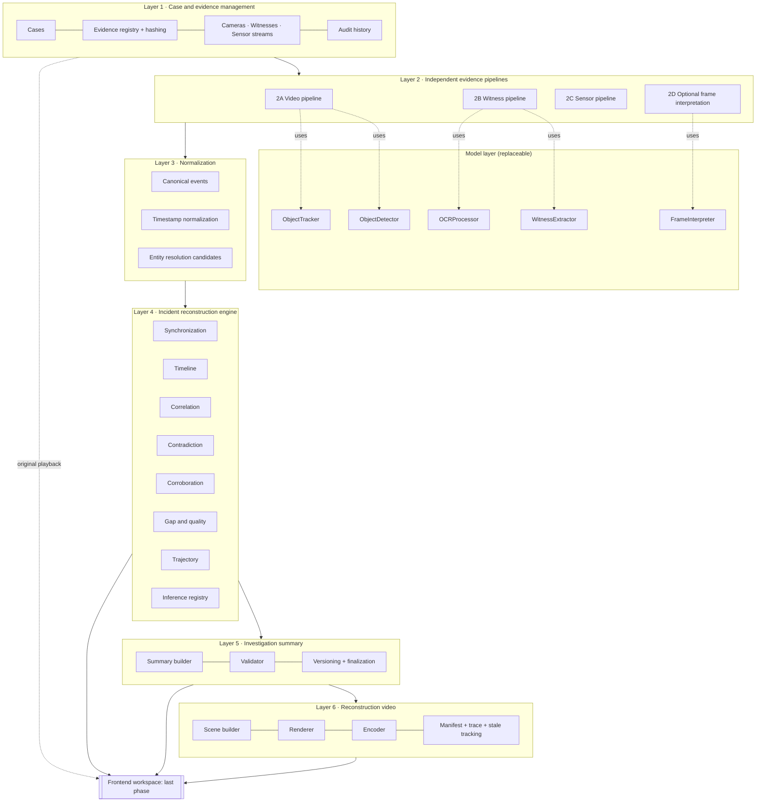
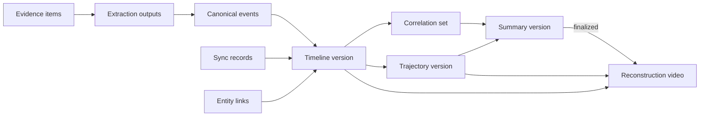

# SYSTEM_ARCHITECTURE

Version 2 (Phase 1). Six layers, one backend, model components behind replaceable interfaces, deterministic engine code, and a frontend built last.

## 1. Architectural style

The backend is a **modular monolith**: one Python package with strict internal boundaries, an HTTP API process, and one or more worker processes running the same code.

- Microservices are not justified for a small team on limited hardware.
- Modules exchange typed Pydantic objects and persisted records, so any module can be split out later.
- The **model layer** (detectors, trackers, LLM/VLM clients, OCR) is separate from the **reconstruction engine** (synchronization, timeline, correlation, trajectories). The engine never calls a model directly; it consumes canonical records.

## 2. Layers



## 3. Technology decisions

| Component | Decision | Reason | v1 |
|---|---|---|---|
| Python 3.11+ | Required | ML/CV ecosystem; dev Mac has 3.9.6 and needs an upgrade | Yes |
| FastAPI + Pydantic v2 | Required | Typed API and one validation layer for API, events, and LLM output | Yes |
| SQLAlchemy 2 + Alembic | Required | Schema and migrations; keeps a SQLite fallback possible | Yes |
| PostgreSQL | Recommended | Relational integrity plus JSONB; Docker is available on the dev Mac | Yes |
| Local filesystem storage | Required | Content-addressed raw store plus a processed store; object storage later | Yes |
| FFmpeg / ffprobe | Required | Metadata, PTS, frame extraction, H.264 encoding of reconstruction videos (not installed yet) | Yes |
| OpenCV | Required | Frame ops, homography, drawing, quality metrics | Yes |
| Pandas, NumPy | Required | Sensor processing | Yes |
| PyProj or GeographicLib | Required when GPS exists | Geodesic and coordinate conversion | P1 |
| Pretrained detector | RF-DETR Small (Apache-2.0) recommended; Ultralytics YOLO26 (AGPL-3.0) as alternative | See MODEL_SELECTION §2 (Phase 2) | Yes |
| ByteTrack (`roboflow/trackers`, Apache-2.0) | Default tracker | Lightweight, motion-only, detector-independent | Yes |
| BoT-SORT (`roboflow/trackers`) | Alternative tracker | Camera-motion compensation for dashcams; chosen by measurement | Evaluate |
| SAM 2, MMAction2 | Optional; justify in Phase 2 | Use only if they materially improve the workflow | No by default |
| PaddleOCR | For scanned statements | Only when no text layer exists | P1 |
| Featherless API | Hosted text and vision inference | OpenAI-compatible; frames only, never raw video | Yes |
| Job system | **Database-backed job queue** with worker processes, behind a `JobRunner` interface | Async processing without extra infrastructure; Redis/Celery can be swapped in if measured load requires it | Yes |
| CARLA | Controlled scenario source, **hardware-blocked** | Needs an NVIDIA GPU on Windows/Ubuntu; no GPU is available (HARDWARE_AND_DEPLOYMENT.md) | Decision pending |
| React + Vite + Tailwind | Frontend | Last phase only | No |

## 4. Replaceable model interfaces

Interface contracts, not implementation:

```python
class ObjectDetector(Protocol):
    model_id: str                      # e.g. "ultralytics/<checkpoint>@<version>"
    def detect(self, frames: list[FrameRef]) -> list[Detection]: ...

class ObjectTracker(Protocol):
    tracker_id: str
    def track(self, detections: Iterable[Detection], fps: float) -> list[Track]: ...

class FrameInterpreter(Protocol):          # optional VLM
    model_id: str
    def interpret(self, frames: list[FrameRef], questions: list[SceneQuestion]) -> list[SceneObservation]: ...

class WitnessExtractor(Protocol):
    model_id: str
    def extract(self, statement: StatementText) -> list[ClaimCandidate]: ...

class OCRProcessor(Protocol):
    engine_id: str
    def read(self, page: ImageRef) -> OCRResult: ...    # text + boxes + per-token confidence
```

Rules:
- Every output carries the producing `model_id` or `tracker_id`, its parameters, and the input hash.
- The engine depends only on the output types (`Detection`, `Track`, `ClaimCandidate`, and so on), never on a concrete model.
- Hosted models (`FrameInterpreter`, `WitnessExtractor`) share an `LLMClient` with caching, rate limiting, retries, a call ledger, and Pydantic validation.

## 5. Storage separation

| Class | Location | Mutability |
|---|---|---|
| Raw evidence | `evidence_store/sha256/...` | Immutable (read-only files, append-only rows) |
| Processed data | `processed/<stage>/<evidence>/<params_hash>/` plus DB rows | Regenerable; keyed by input and parameters |
| Derived conclusions | DB: events, correlations, gaps, trajectories, inferences, timeline versions | Append-only with versions |
| Generated artifacts | `artifacts/<case>/summaries/`, `artifacts/<case>/videos/` | Immutable once written; superseded by new versions |
| Ground truth | `ground_truth/` | Readable only by the evaluation harness |

## 6. Versioning and staleness

Every derived artifact records the versions of its inputs. Changing an input creates a new version and marks dependants **stale**.



A reconstruction video is **current** only when its summary version is the latest finalized one and its timeline and trajectory versions match that summary. Otherwise it is stale, with a stored diff of changed finding IDs.

## 7. Processing model

- The API enqueues jobs; workers execute them. Each stage is idempotent, keyed by `(stage, input_hash, params_hash)`.
- Long stages (frame extraction, detection, tracking, rendering) report progress.
- Stage dependencies form a DAG per case. A failed stage blocks only its dependants and is listed in the summary's limitations.
- Jobs carry a `case_policy` that includes `allow_external_inference`. When it is false, the hosted LLM/VLM stages are skipped and recorded as not run.

## 8. External inference integration

```
module → LLMClient.call(task, schema, inputs)
  → policy check (case allows external inference?)
  → cache lookup (model, params, prompt_hash, input_hash)
  → concurrency limiter (sized to the Featherless plan's units)
  → POST https://api.featherless.ai/v1/chat/completions
  → Pydantic validation → one repair attempt → failure is recorded, never silently patched
  → ledger + cache write
```

Configuration comes from environment variables: `FEATHERLESS_API_KEY`, `FEATHERLESS_TEXT_MODEL`, `FEATHERLESS_VISION_MODEL`. Numeric and temporal work is deterministic code only.

## 9. Error handling

| Failure | Response |
|---|---|
| Corrupt or undecodable file | Evidence marked invalid, file kept, other sources proceed |
| Model API 429/5xx/timeout | Exponential backoff with jitter, bounded attempts, circuit breaker; job marked failed and retryable |
| Invalid structured output | One repair attempt, then the extraction is stored as failed |
| No detections | Recorded as zero detections; absence is never inferred |
| Missing timestamps | Lower-reliability clock basis or unsynchronized group, stated explicitly |
| Missing calibration | Trajectories limited to image space or schematic |
| Render failure | Video job failed; summary unaffected |
| Partial pipeline | Summary lists stages run, skipped, and failed |

## 10. Observability

- JSON logs with `case_id`, `job_id`, `evidence_id`, `stage`, `duration_ms`.
- A model-call ledger (model, parameters, hashes, tokens, latency, status).
- Per-case processing report: counts per stage, failures, stale artifacts.
- Logs contain no secrets and no statement text by default.

## 11. Security summary

See SECURITY_AND_EVIDENCE_INTEGRITY.md: hashing at ingest, immutable raw store, hash-chained audit log, role-based access, per-case external-inference control, and secret handling.

## 12. Scalability (not a v1 goal)

Stateless API, a job queue replaceable by Redis/Celery, storage replaceable by object storage, and detectors replaceable by GPU services. No scaling claims are made.

## 13. Related documents

Pipelines: VIDEO_PROCESSING_ARCHITECTURE, WITNESS_PROCESSING_ARCHITECTURE, SENSOR_PROCESSING_ARCHITECTURE. Engine: SYNCHRONIZATION_ARCHITECTURE, INCIDENT_RECONSTRUCTION_ENGINE, CONTRADICTION_DETECTION, TRAJECTORY_RECONSTRUCTION. Outputs: INVESTIGATION_SUMMARY, RECONSTRUCTION_VIDEO_ARCHITECTURE. Contracts: EVENT_SCHEMA, DATABASE_SCHEMA, API_SPECIFICATION.
